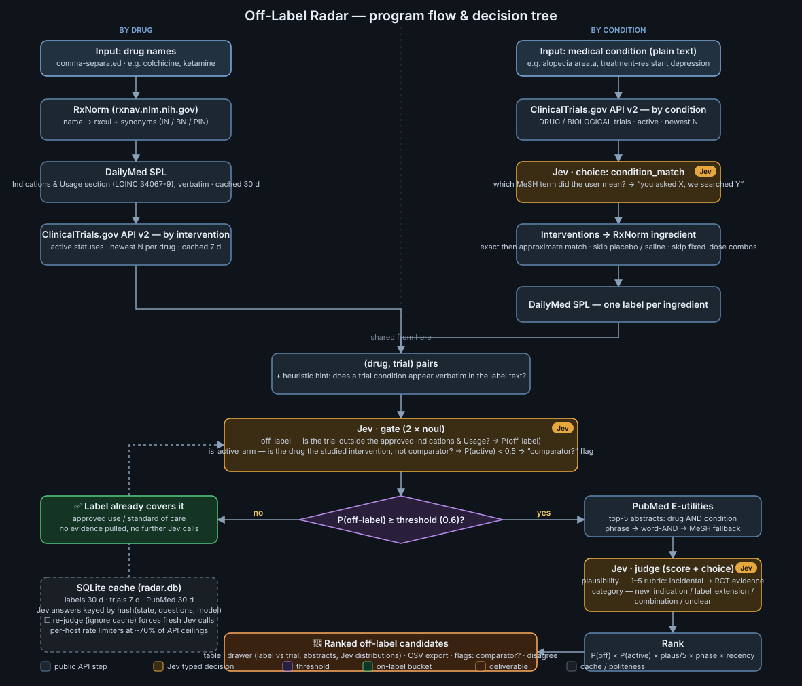
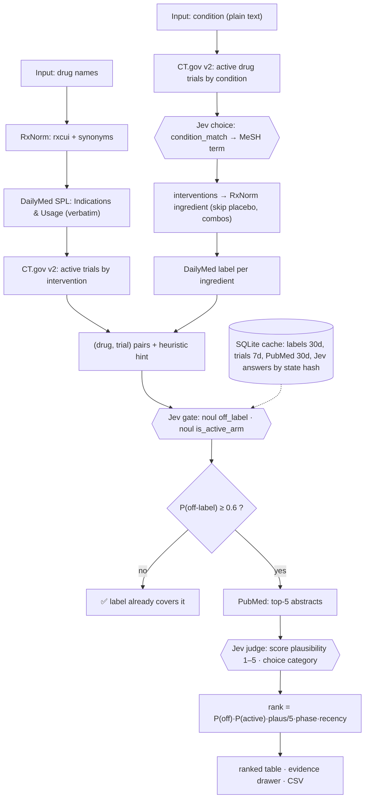

# Off-Label Radar

**Every active clinical trial × every FDA label, judged by [Jev](https://typesafe.ai) for cents.**
Finds approved drugs that are being tested *outside their labeled indications* — the ClinicalTrials.gov-vs-DailyMed diff nobody publishes — and ranks them with typed probabilities you can threshold, not prose.

Two ways in:

- **By drug** — `colchicine, ketamine, …` → every active trial for each drug, diffed against its label.
- **By condition** — `alopecia areata` in plain words → every drug being tested for it, split into **label already covers it** (approved use) vs **being tested off-label** (the repurposing signal).

No scraping: ClinicalTrials.gov API v2, DailyMed SPL web services, RxNorm and PubMed E-utilities are all used through their public APIs, throttled to ~70 % of their documented ceilings, with an identified `User-Agent` and a SQLite cache so re-runs cost zero requests.

> Research signal from public registries and labels — **not medical advice**.

📘 **Run it locally / deploy it:** see [RUNBOOK.md](RUNBOOK.md).

## Where Jev's three question types are used

| Jev type | Question | Input | Result |
|---|---|---|---|
| `noul` **off_label** | Is the trial testing the drug outside its approved *Indications & Usage*? | label section verbatim + trial record | **P(off-label)** — gate at 0.6 |
| `noul` **is_active_arm** | Is the drug the studied intervention, not a comparator / background therapy? | trial arms & interventions | **P(active)** — `comparator?` flag, multiplies rank |
| `score` **plausibility** | 5-level rubric: incidental → indirect → preclinical → human data → RCTs | top-5 PubMed abstracts | **Plausibility 1–5** |
| `choice` **category** | new_indication / label_extension / combination / unclear | everything above | **Category** badge + full distribution |
| `choice` **condition_match** | Which MeSH term is what the user typed? (condition mode) | CT.gov's MeSH terms for the search | "you asked X, we searched Y" |

Rank = P(off) × P(active) × plausibility/5 × phase weight × recency.

## Program flow / decision tree





## Layout

```
main.py        FastAPI: / (UI), /api/status, /api/run, /api/run_condition, /api/candidates, /api/conditions, /api/export.csv, /readyz
pipeline.py    drug mode: RxNorm → DailyMed → CT.gov → pairs → Jev gate → PubMed → Jev judge → rank
condition.py   condition mode: CT.gov by condition → Jev MeSH match → ingredients → labels → shared gate/judge
jev.py         the four Jev questions, state builders, cached ask()
net.py         per-host rate limiters, backoff/Retry-After, run counters
db.py          SQLite schema + queries (radar.db)
cli.py         headless runner:  python cli.py colchicine ketamine [--force] | --condition "alopecia areata"
static/        UI (vanilla JS), flow.svg
docs/flow.svg  this diagram
```

Built at a hackathon for the *Firehose* track (AI on tasks that used to be too expensive). Demo notes are in the runbook.